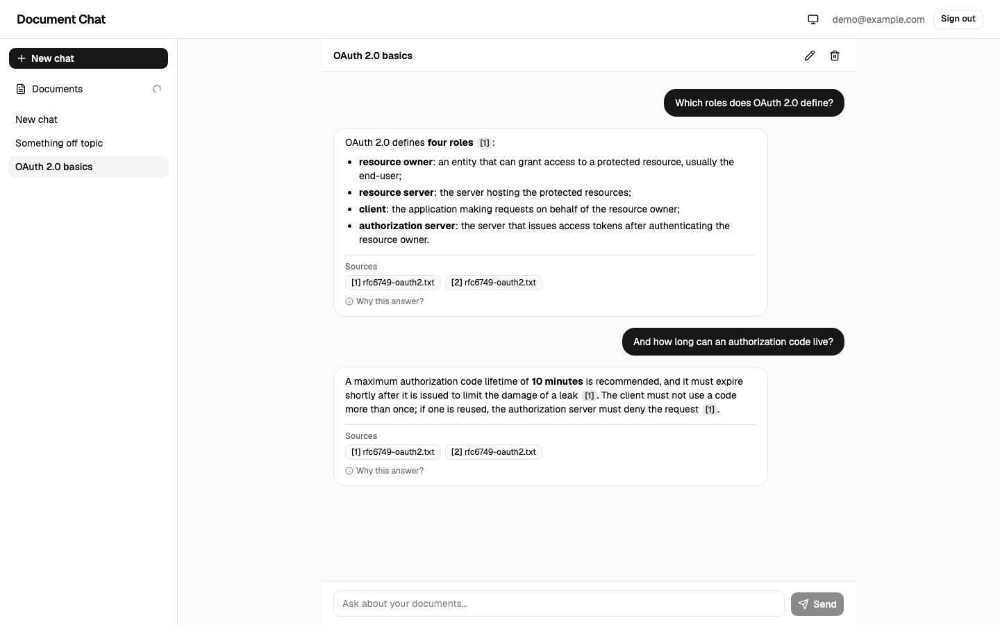
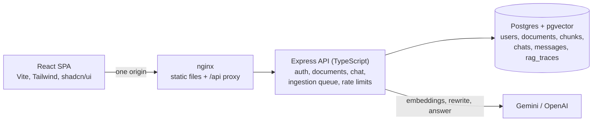
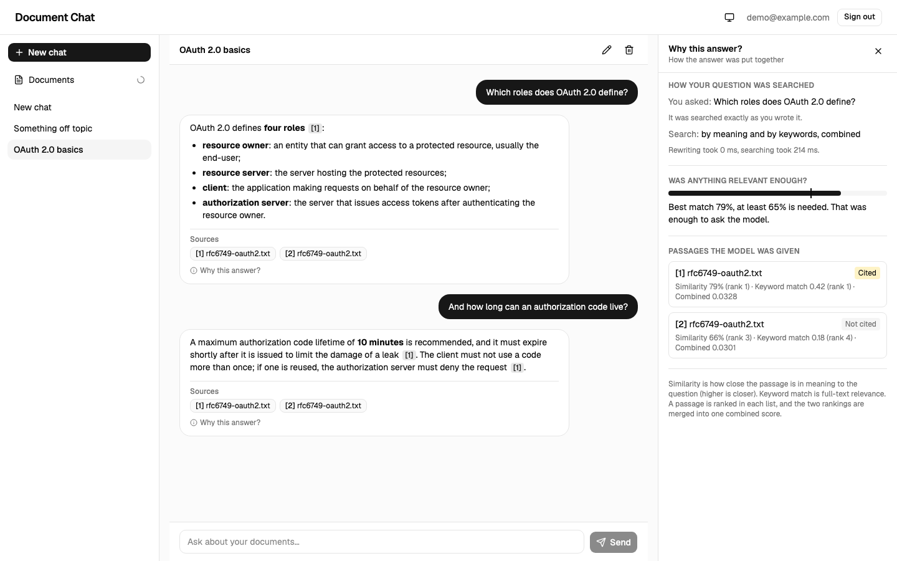
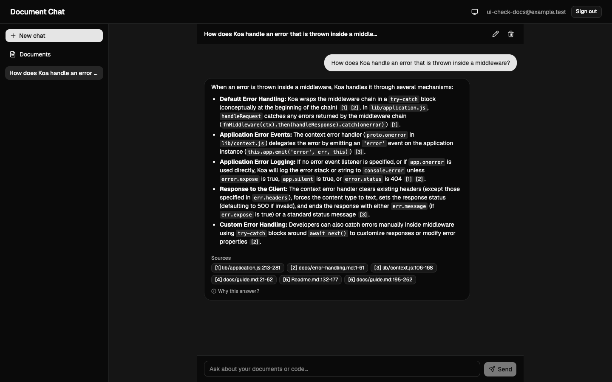
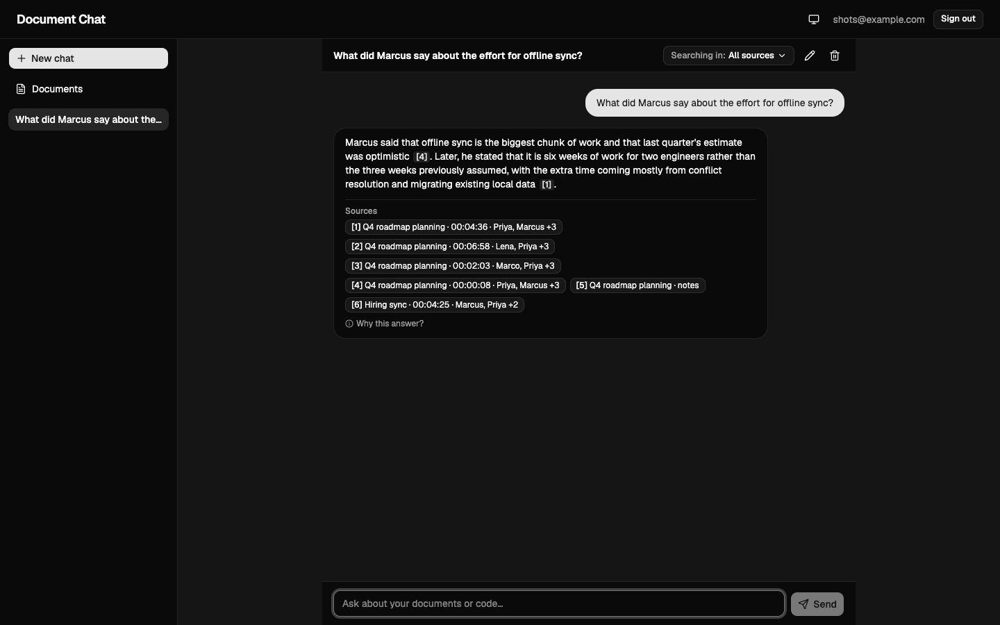
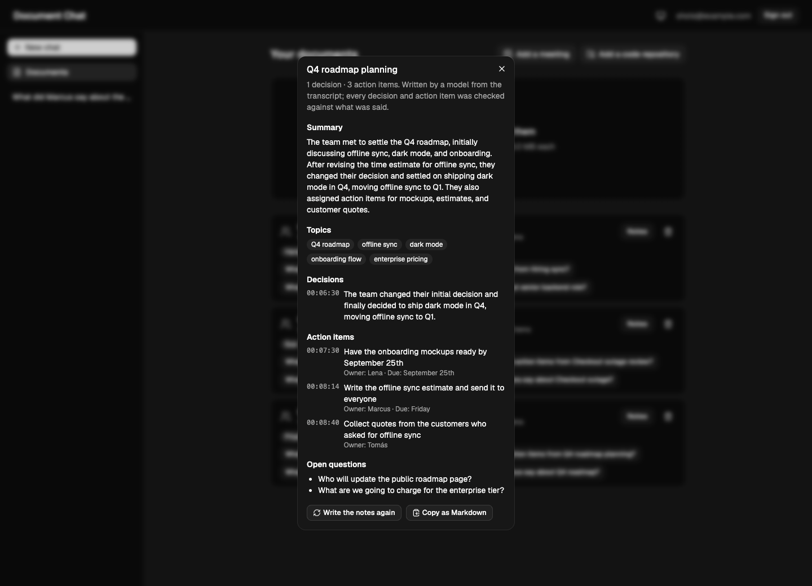

# Document Chat

A web app for asking questions about your own sources. Add documents, a code repository, meetings or a resume with job postings, then chat. Answers are streamed, grounded in what you added, and cite where each statement came from. If the sources don't contain the answer, the app says so instead of guessing.



<!-- Live demo: add the Render link here. -->

## What it does

**Documents** (PDF, TXT, Markdown)

- Upload one or many files; they are read, split, embedded and shown as _Ready_ with their size and status.
- Answers cite the file and page; clicking a citation opens the passage in context.
- Suggested questions are generated for every document.

**Code repositories** (a public GitHub address or a zip archive)

- Imported safely: fixed hosts, no redirects, path and zip-bomb guards, secrets and `.env` files are never indexed.
- Code is cut along its structure and searched by meaning and by identifier (`createAuthRouter` also matches "create auth router").
- An overview passage (file tree, dependencies, entry points) answers "how is this project structured?".
- Citations show `path:lines`; the viewer highlights the lines and links to the same commit on GitHub.

**Meetings** (a TXT or WebVTT transcript, or a recording)

- A strict transcript parser; a recording (mp3, wav, m4a, webm; file or microphone) is transcribed with speakers and times, and the audio is never stored.
- Notes are written once: summary, decisions, action items with owners and deadlines, open questions. Every item must quote the transcript or it is dropped.
- Questions that name a speaker or a time ("what did Marcus say…", "in the first ten minutes") narrow the search first.
- Citations show title, time and speakers; the viewer colours each speaker.

**Resume and job postings** (one resume, up to ten postings)

- Contact details and personal attributes are removed from the resume before it is indexed or sent to a model.
- Each requirement of a posting is rated _shown_, _partly shown_ or _not shown in the resume_, and a rating counts only with a quote the code finds in the resume.
- Years of experience and the share of requirements are computed by code, never by the model. No "match score", no advice on whether to apply.
- A Career page shows the postings by fit, the requirement table and the gaps shared by several postings.
- Questions can name a posting ("Job #2", "the Platform Engineer role"); "which job fits me best?" and "prepare me for Job #2" work too.

**Across all of them**

- A chat can be limited to chosen sources ("Searching in" menu).
- "Why this answer?" shows the search, the passages and their scores; refusals show the closest passages that were set aside.
- Everything that comes from a file or a model is treated as untrusted data: an instruction hidden in a document, a repository, a transcript or a resume is not followed.
- Accounts, 20 sources and 100 chats per user, question limits, light and dark theme, phone width.

## Quick start

You need Docker and a free [Gemini API key](https://aistudio.google.com/apikey). Without a key the app starts, but indexing and chat report "not configured".

```bash
git clone https://github.com/dev-marian-vybyranyi/rag-document-chat.git
cd rag-document-chat
cp .env.example .env          # put your key into GOOGLE_GENERATIVE_AI_API_KEY
docker compose up --build     # open http://localhost:8080
```

Register, open **Documents**, and add something from `samples/` (documents, `samples/meetings`, `samples/career`) or a small public repository such as `https://github.com/octocat/Spoon-Knife`. Wait for **Ready**, then ask.

- Development: `npm install`, `docker compose up -d db`, `npm run dev` (web :5173, API :3000).
- Checks: `npm run lint && npm run typecheck && npm test && npm run build` (about 4,000 tests; none calls a real model).
- Deploy: `render.yaml` is a Render Blueprint (free Postgres and two free Docker services); migrations run on API start.
- Settings are environment variables, documented in `.env.example`. `AI_PROVIDER=openai` switches chat and embeddings to OpenAI.

## How it works



- **Stack:** React 19, Vite, Tailwind, shadcn/ui; Express 5, TypeScript, Drizzle; Postgres with pgvector; Vercel AI SDK only for model calls and streaming. No LangChain or LlamaIndex.
- **One table for every source:** documents, repositories, meetings, resumes and postings are rows of `documents` with a `kind`; their chunks carry the location (page, lines, time and speakers, resume section). Search, citations, scoping and traces are shared.
- **Indexing** runs in the API process behind a `202`: extract, chunk, embed in paced batches, write in one transaction.
- **Answering:** rewrite the follow-up, then vector and keyword search for this user only, merge by reciprocal rank fusion, refuse without calling the model if the best similarity is below the threshold, otherwise stream an answer, remove citations to sources that don't exist, and save a trace.

## Quality

Evaluations call real models, so they are run by hand: `npm run eval:retrieval`, `eval:faithfulness`, `eval:code`, `eval:meetings`, `eval:career` (add `-w @rag-chat/api`).

| Search, top 6, real embeddings | hit@1 | hit@6 | Questions |
| ------------------------------ | ----- | ----- | --------- |
| Documents, hybrid (the app)    | 72%   | 95%   | 57        |
| Code (Koa), hybrid             | 58%   | 92%   | 38        |
| Meetings, hybrid with filters  | 78%   | 100%  | 46        |

The sets are small and written by one person, so these are regression signals, not a benchmark. Not measured yet: the resume and postings part (the evaluation is written and tested but has not been run on a real model, so no numbers are quoted), faithfulness of answers, anything on OpenAI. Details and caveats are in [`docs/DETAILS.md`](docs/DETAILS.md).

## Guardrails

- Prompt injection: fixed instructions, escaped and delimited sources, invisible characters stripped, no tools for the model, retrieval scoped to the user in SQL.
- Citation validation, input limits, per-user rate limits, quota errors told apart and shown with the wait.
- One JSON error shape with a request id; JSON logs; a `rag_traces` row per question.

## More

- [`docs/DECISIONS.md`](docs/DECISIONS.md): every non-obvious choice, what else was considered, what it costs.
- [`docs/DETAILS.md`](docs/DETAILS.md): how each part works, evaluation tables, guardrails, what to change to run this in production (AWS and equivalents), engineering standards, how AI tools were used, what I would do with more time, all screenshots.
- [`CLAUDE.md`](CLAUDE.md): commands and conventions for AI assistants working in the repository.

## Screenshots

|                                                             |                                                       |
| ----------------------------------------------------------- | ----------------------------------------------------- |
|  |  |
| "Why this answer?": search, relevance, passages, scores     | A code answer with `path:lines` citations             |
|    |        |
| A meeting answer with speaker and time citations            | Notes: summary, decisions, action items with owners   |
